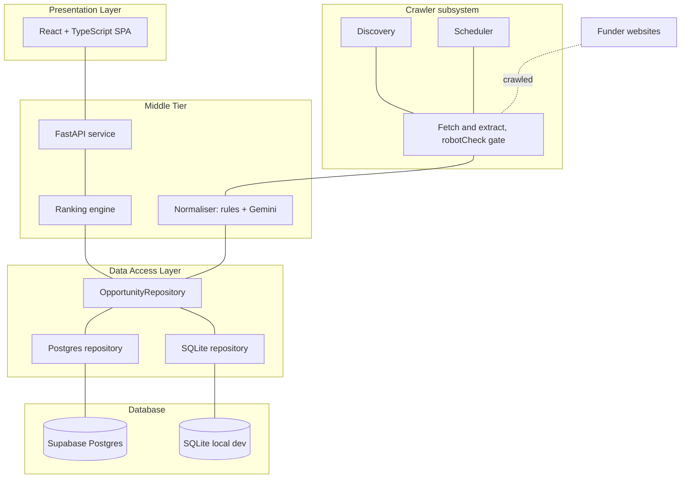

# Architecture Overview — Find Me Funding

> Snapshot of the Confluence page [Architecture Overview — Find Me Funding](https://annaseku01.atlassian.net/wiki/spaces/Crawlers/pages/30834690), taken 23 October 2026. The live page needs an Atlassian login. The client is referred to by role, not by name.

**Status** Current  ·  **Owner** Anna Sekulic  ·  **Last reviewed** 9/21/2026

Created in response to supervisor feedback asking for _one overall system design diagram_. This page is the single answer to the "Architectural Design" item on the progress checklist.

## Purpose

One picture of the whole system, so a reader can see every layer and every boundary without opening the codebase. Reasoning for individual choices lives in the ADRs linked at the bottom; this page is the map, not the argument.

**High level view.** What the system does and what it talks to, on one page.

## System design diagram

Four layers, read top to bottom. The system has **two independent entry points** into the data layer — a user search, and the crawler running on its own schedule — and that separation is the most important structural fact about it.

The same layers as a table, so the content is searchable:

| Presentation Layer | **React + TypeScript single-page app** Vite build · Home and Results pages · Navbar, Dropdown, Result components · `fundingService.ts` calls the API |
| --- | --- |
| Middle Tier | **FastAPI service** `POST /api/search` · `GET /api/opportunities/{id}` · `GET /api/health` **Ranking engine** — eligibility, deadline, funding value, research match, configurable weights | **Crawler subsystem** Discovery (`discoverURL`, `queryBuilder`) · fetch and extract behind a `robotCheck` gate · scheduler for staleness-driven re-crawls **Normaliser** — deterministic rules first, Gemini extraction for prose-derived fields |
| --- | --- | --- |
| Data Access Layer | `OpportunityRepository` — the single seam. Exposes only `all()` and `get()`. Implementations: mock JSON fixture · SQLite repository · Postgres repository |
| --- | --- |
| Database | **Supabase Postgres** — deployed environment | **SQLite** — local development |
| --- | --- | --- |
| External | Funder websites (crawl targets, robots.txt respected) · Google Gemini API (field extraction) |
| --- | --- |

Kept as the source of truth so the diagram can be regenerated when the architecture changes, rather than redrawn by hand.

## The two request paths

Everything in the system is one of these two flows.

| Path | Trigger | Flow |
| --- | --- | --- |
| **Search** | A user submits a search in the browser | SPA → `POST /api/search` → ranking engine → `OpportunityRepository.all()` → ranked page of results returned |
| **Ingest** | The scheduler, on its own clock | Discovery builds candidate URLs → `robotCheck` gate → fetch and extract → normaliser (rules, then Gemini for prose fields) → written to the store |

## The key architectural seam

`OpportunityRepository` is the decision that makes the rest of the system movable. The API only ever calls `all()` and `get()`, so the mock fixture, SQLite and Postgres are interchangeable behind it, and the crawler can fill the same store without the search path knowing anything about how the data arrived.

The practical consequence: swapping the mock data set for crawler-populated Postgres replaced one class and changed nothing else. That is the property the system was designed for.

## What this diagram deliberately does not show

There is **no path from search to crawl**. A search ranks what is already indexed; it never triggers a fetch. This is a deliberate decision, not an omission — it keeps search latency bounded, and keeps crawl politeness under our own scheduling control rather than under user load.

Also out of scope at this stage: user accounts and saved researcher profiles (the `mock_profiles.json` fixture stands in for these), and any notification or alerting layer.

## Technical services supporting the system

* **CI** — ruff lint and format checks; pytest across Python 3.11, 3.12 and 3.13 against a real Postgres service container; a Docker build check; ESLint and TypeScript strict build; Vitest.
* **Ranking evaluation** — a golden-set eval harness run as a CI gate, so ranking changes cannot silently regress.
* **CD** — backend to Render, frontend published from the build pipeline.

These are documented in full on the CI/CD Pipeline and Test Strategy pages.

## Detailed diagrams

Each diagram has its own page in the **Architecture Diagrams** folder, next to this page in the tree:

* [High Level Architecture](high-level-architecture.md)
* [System Architecture (Layered)](system-architecture-layered.md)
* [Component Diagram](component-diagram.md)
* [Deployment Diagram](deployment-diagram.md)
* [Database ER Diagram](database-er-diagram.md)
* [Domain Class Diagram](domain-class-diagram.md)
* [Sequence Diagram — Search for Funding](sequence-diagram-search-for-funding.md)
* [Sequence Diagram — Discover and Ingest](sequence-diagram-discover-and-ingest.md)
* [Ranking Activity Diagram](ranking-activity-diagram.md)
* [Opportunity Lifecycle (State Diagram)](opportunity-lifecycle-state-diagram.md)
* [Use Case Diagram](use-case-diagram.md)

Editable draw.io sources live in the repository under `docs/diagrams/`.

## Related pages and decisions

* adr-001-technology-decisions.md — language and framework split (React + Python API)
* crawler-architecture-decisions.md
* general-crawler-architecture.md
* api-contract.md

ADR-002 (ranking engine), ADR-003 (normaliser) and ADR-004 (hosting and persistence) are still to be published to Confluence; ADR-002 and ADR-003 currently exist only in the repository under `docs/adr/`.
