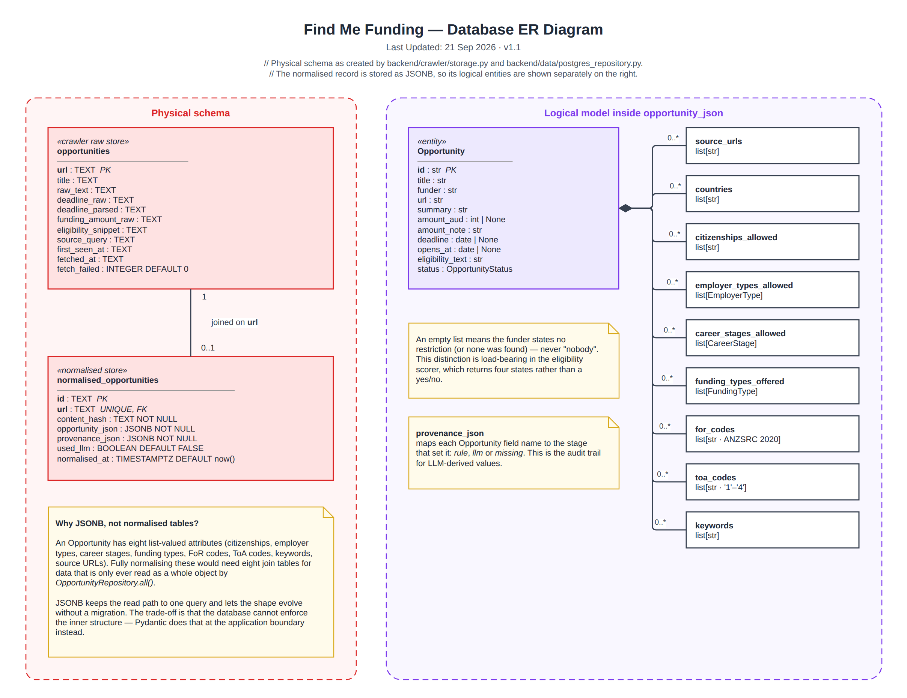

# Database ER Diagram

> Snapshot of the Confluence page [Database ER Diagram](https://annaseku01.atlassian.net/wiki/spaces/Crawlers/pages/31621141), taken 25 October 2026. The live page needs an Atlassian login. The client is referred to by role, not by name.

Physical schema on the left; the logical model stored inside opportunity_json on the right.

Click the image to view it full size. Editable source: `docs/diagrams/er-diagram.drawio` in the repository (PNG export in `docs/diagrams/png/`). Where this page and the repository disagree, the repository wins.

Part of the architecture set — start at [Architecture Overview — Find Me Funding](architecture-overview-find-me-funding.md).
