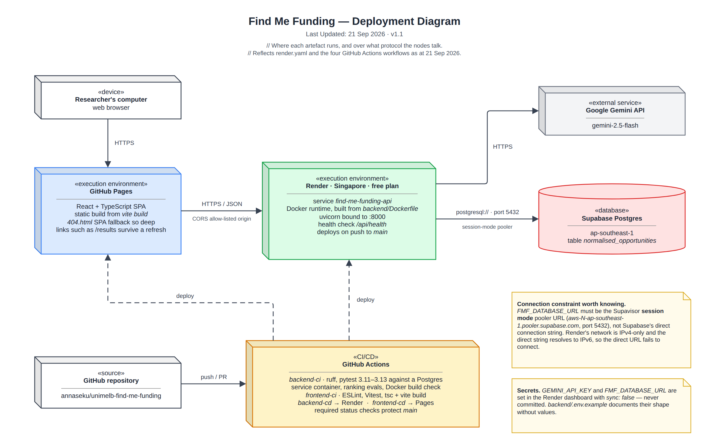

# Deployment Diagram

> Snapshot of the Confluence page [Deployment Diagram](https://annaseku01.atlassian.net/wiki/spaces/Crawlers/pages/31653889), taken 25 October 2026. The live page needs an Atlassian login. The client is referred to by role, not by name.

Where each artefact runs and over what protocol the nodes talk: GitHub Pages, Render, Supabase, Gemini and GitHub Actions.

Click the image to view it full size. Editable source: `docs/diagrams/deployment-diagram.drawio` in the repository (PNG export in `docs/diagrams/png/`). Where this page and the repository disagree, the repository wins.

Part of the architecture set — start at [Architecture Overview — Find Me Funding](architecture-overview-find-me-funding.md).
