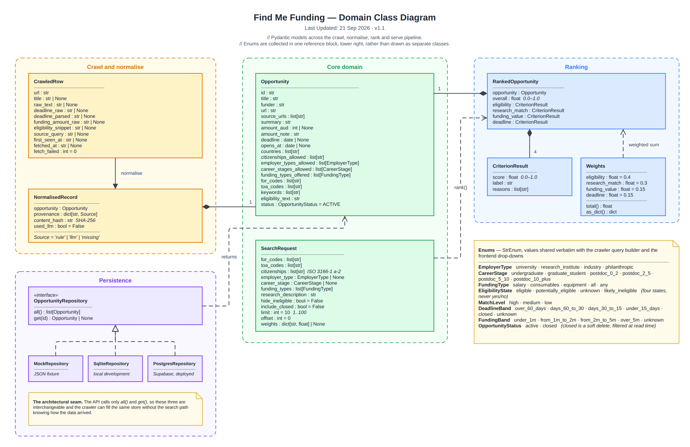

# Domain Class Diagram

> Snapshot of the Confluence page [Domain Class Diagram](https://annaseku01.atlassian.net/wiki/spaces/Crawlers/pages/31326250), taken 25 October 2026. The live page needs an Atlassian login. The client is referred to by role, not by name.

Pydantic models across the crawl, normalise, rank and serve pipeline.

Click the image to view it full size. Editable source: `docs/diagrams/domain-class-diagram.drawio` in the repository (PNG export in `docs/diagrams/png/`). Where this page and the repository disagree, the repository wins.

Part of the architecture set — start at [Architecture Overview — Find Me Funding](architecture-overview-find-me-funding.md).
