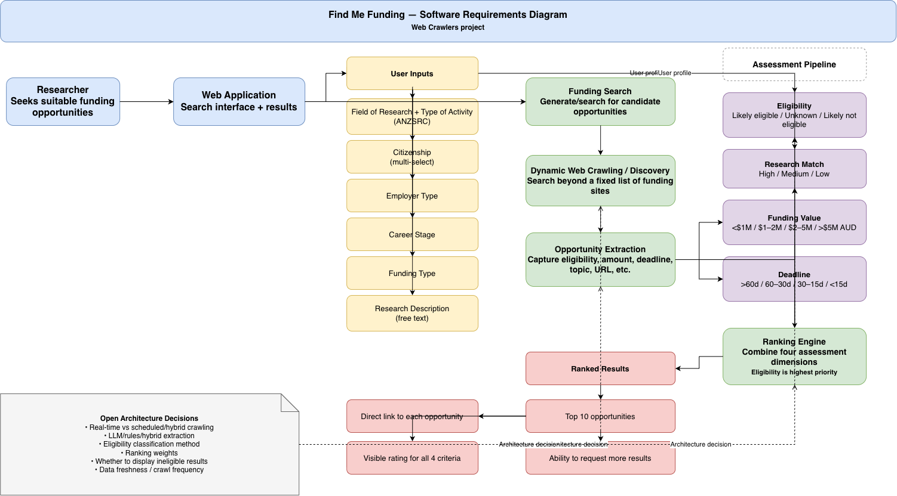

# Functional and Non-Functional Requirements

> Snapshot of the Confluence page [Functional and Non-Functional Requirements](https://annaseku01.atlassian.net/wiki/spaces/Crawlers/pages/5373953), taken 23 October 2026. The live page needs an Atlassian login. The client is referred to by role, not by name.

# Requirements Diagram — Web Crawlers / Find Me Funding

## Purpose

This diagram translates the current Crawlers brief and project notes into a single requirements view for the software build. It separates **confirmed client requirements** from **implementation decisions / open questions**.

‌

## Use case diagram

‌

## Functional requirements represented

| ID | Requirement | Priority | Status |
| --- | --- | --- | --- |
| FR-01 | Web application for researchers seeking funding opportunities | Must have |  |
| FR-02 | Dynamic web crawling/discovery rather than a fixed curated list of funding sites | Must have |  |
| FR-03 | Search using FoR and ToA based on ANZSRC | Must have |  |
| FR-04 | Support multiple citizenship selections | Must have |  |
| FR-05 | Capture employer type | Must have |  |
| FR-06 | Capture career stage | Must have |  |
| FR-07 | Capture requested funding type | Must have |  |
| FR-08 | Capture free-text research description | Must have |  |
| FR-09 | Assess funding opportunity eligibility | Must have |  |
| FR-10 | Assess match to user input | Must have |  |
| FR-11 | Assess funding value | Must have |  |
| FR-12 | Assess time to deadline | Must have |  |
| FR-13 | Rank opportunities using the four assessment dimensions | Must have |  |
| FR-14 | Return top 10 funding opportunities | Must have |  |
| FR-15 | Allow users to request more results | Must have |  |
| FR-16 | Provide direct link to each opportunity | Must have |  |
| FR-17 | Display the rating for each ranking criterion | Must have |  |
| FR-18 | English-language content only | Must have |  |
| FR-19 | Web application; native mobile app not required | Must have |  |

## Key non-functional / system constraints

* **Coverage:** the system must discover opportunities dynamically across the web; a hardcoded list of major funding databases does not satisfy the brief.
* **Eligibility quality:** eligibility matching is explicitly the most important criterion. A strong topical match is not useful if the researcher is ineligible.
* **Explainability:** each returned opportunity should expose its ratings against eligibility, user match, funding value, and deadline.
* **Freshness:** funding information is time-sensitive, so the crawling/indexing approach must account for changes to opportunities and deadlines.

## Open architecture decisions

These are deliberately shown as dashed dependencies in the diagram because they are **not yet confirmed requirements**:

1. **Crawling strategy:** real-time crawling vs scheduled crawling/indexing vs a hybrid approach.
2. **Opportunity extraction:** rules/structured extraction vs LLM-assisted extraction vs hybrid.
3. **Eligibility classification:** how to map complex site-specific eligibility rules to likely eligible / unknown / likely not eligible.
4. **Ranking weights:** relative weighting of eligibility, match, funding value, and deadline.
5. **Ineligible results:** whether they are removed entirely, shown with a warning, or retained at the bottom of the ranking.
6. **Data freshness:** crawl frequency and how stale opportunities are handled.

## Traceability

The diagram is based primarily on **Project Information - Web Crawlers** and **Project Description: Support for UoM Research Office** in the Crawlers space. The project information page explicitly identifies dynamic crawling as a hard requirement and eligibility as the highest-priority concern.
