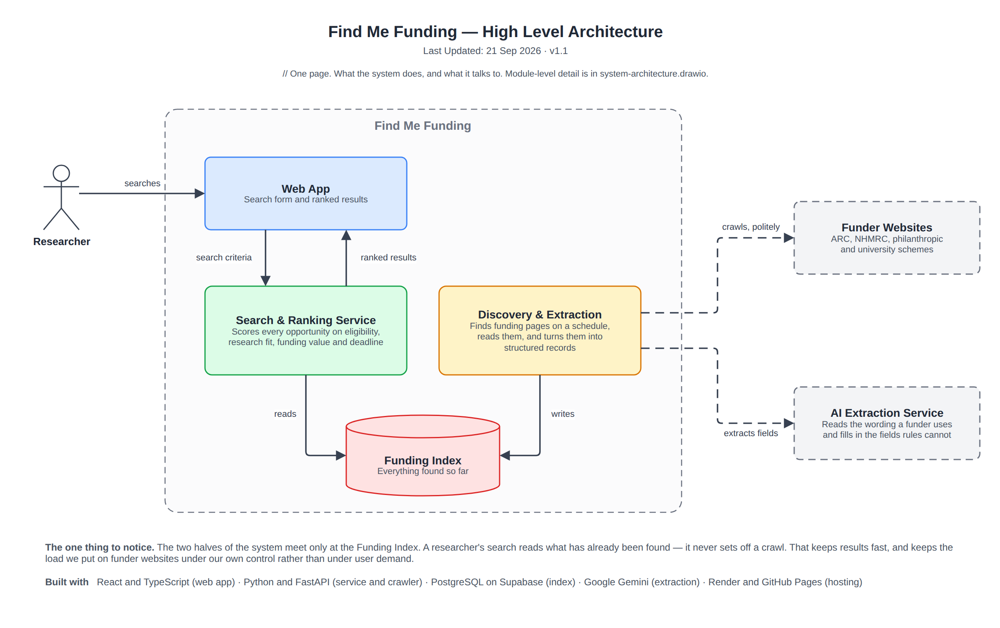

# High Level Architecture

> Snapshot of the Confluence page [High Level Architecture](https://annaseku01.atlassian.net/wiki/spaces/Crawlers/pages/31490049), taken 23 October 2026. The live page needs an Atlassian login. The client is referred to by role, not by name.

One page: what the system does and what it talks to. The two halves meet only at the Funding Index, so a search never sets off a crawl.

Click the image to view it full size. Editable source: `docs/diagrams/high-level-architecture.drawio` in the repository (PNG export in `docs/diagrams/png/`). Where this page and the repository disagree, the repository wins.

Part of the architecture set — start at [Architecture Overview — Find Me Funding](architecture-overview-find-me-funding.md).
