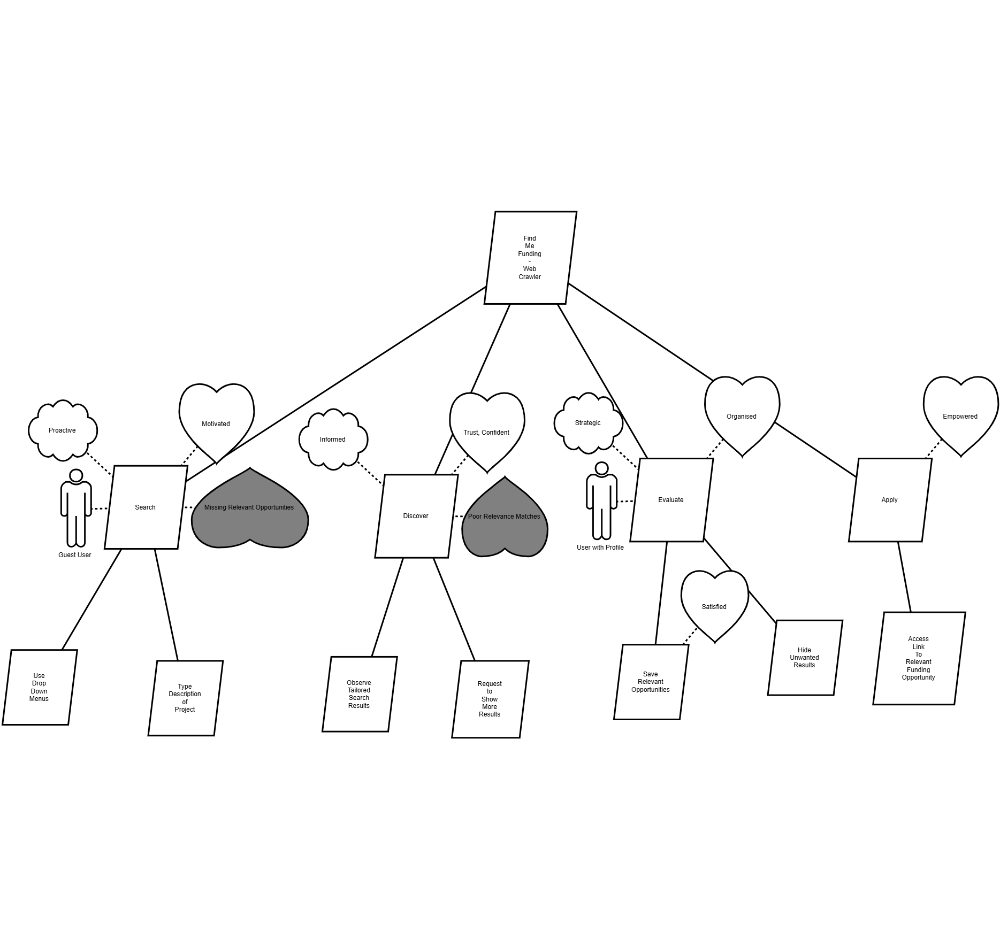

# Motivational Modelling

> Snapshot of the Confluence page [Motivational Modelling](https://annaseku01.atlassian.net/wiki/spaces/Crawlers/pages/11141121), taken 23 October 2026. The live page needs an Atlassian login. The client is referred to by role, not by name.

Motivational Model for Find Me Funding - Web Crawler
**Search** User is able to use drop-down menu’s and description box to specify details of research/project they desire to find funding for.

They want to BE proactive and purposeful in their search for funding and FEEL motivated and in control when communicating their research needs to the web crawler.

‌

**Discovery** User is able to view results and discover funding opportunities of a broad scope. They are able to view the top 10 most eligible results and key information related to the search enquiry, and able to ask the web crawler for more results.

They want to BE informed by the web crawler, which provides information in a easy-to-understand manner. They want to FEEL confident and reassured that the search tool understands their priorities, surfaces relevant opportunities and trust that it will return the most relevant eligible grants. 

‌

**Evaluation** Users who create a profile are able to evaluate results, saving those that they want to return to and hiding results that do not suit their desires.

They want to BE strategic and selective in their evaluation of search results, and FEEL organised, confident and satisfied when identifying and saving funding opportunities that are relevant to their research. The ability to hide unwanted results helps them reduce noise and focus on opportunities that are worth pursuing.

‌

**Application** Users have easy access to apply for funding opportunities returned by the search as it returns a link to apply. 

They want to BE prepared and decisive to undertake the next step to apply for their relevant funding and FEEL empowered and excited to take the next step towards securing funding for their research project.

‌
