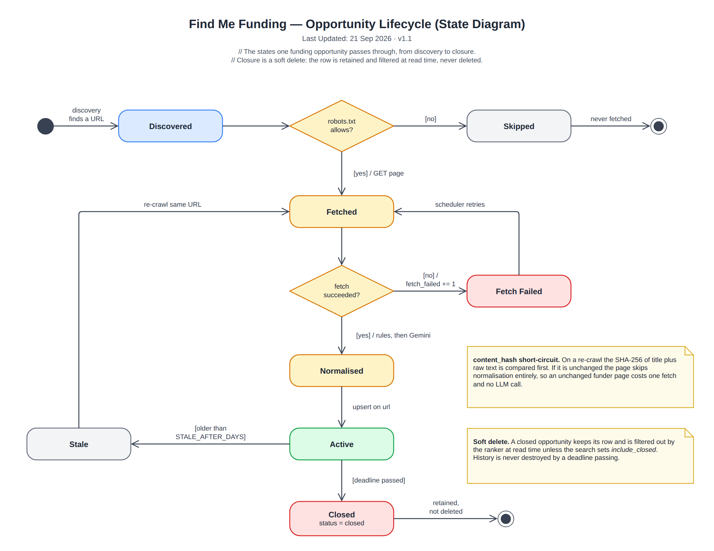

# Opportunity Lifecycle (State Diagram)

> Snapshot of the Confluence page [Opportunity Lifecycle (State Diagram)](https://annaseku01.atlassian.net/wiki/spaces/Crawlers/pages/31522837), taken 23 October 2026. The live page needs an Atlassian login. The client is referred to by role, not by name.

The states one opportunity passes through, from discovery to soft-deleted closure.

Click the image to view it full size. Editable source: `docs/diagrams/state-opportunity-lifecycle.drawio` in the repository (PNG export in `docs/diagrams/png/`). Where this page and the repository disagree, the repository wins.

Part of the architecture set — start at [Architecture Overview — Find Me Funding](architecture-overview-find-me-funding.md).
