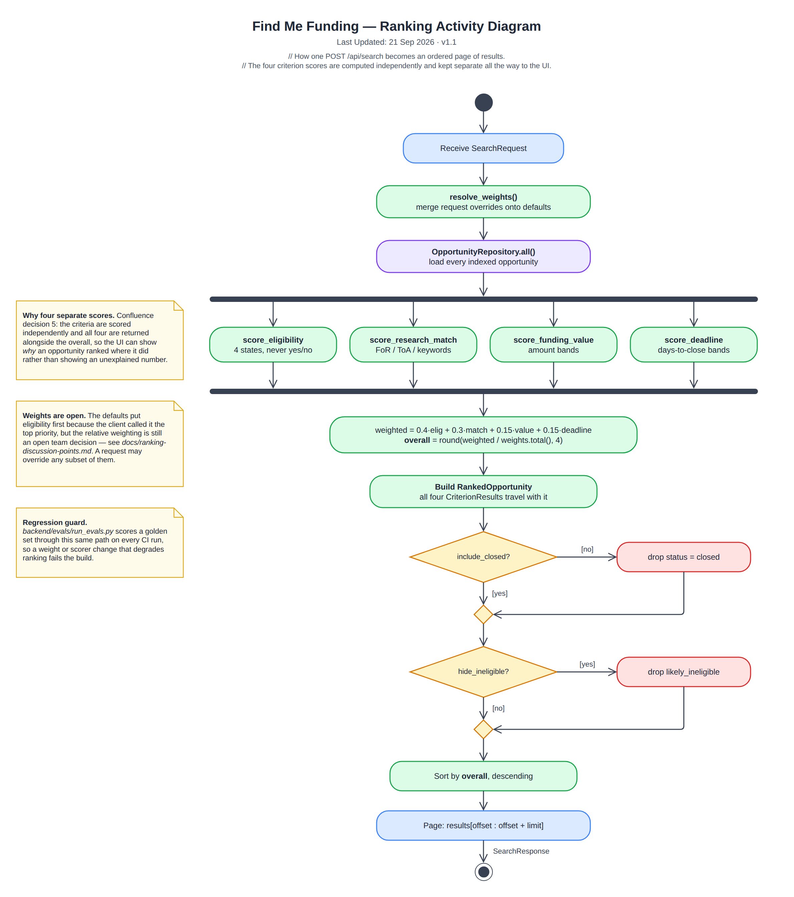

# Ranking Activity Diagram

> Snapshot of the Confluence page [Ranking Activity Diagram](https://annaseku01.atlassian.net/wiki/spaces/Crawlers/pages/30867479), taken 25 October 2026. The live page needs an Atlassian login. The client is referred to by role, not by name.

How one POST /api/search becomes an ordered page of results.

Click the image to view it full size. Editable source: `docs/diagrams/activity-ranking.drawio` in the repository (PNG export in `docs/diagrams/png/`). Where this page and the repository disagree, the repository wins.

Part of the architecture set — start at [Architecture Overview — Find Me Funding](architecture-overview-find-me-funding.md).
