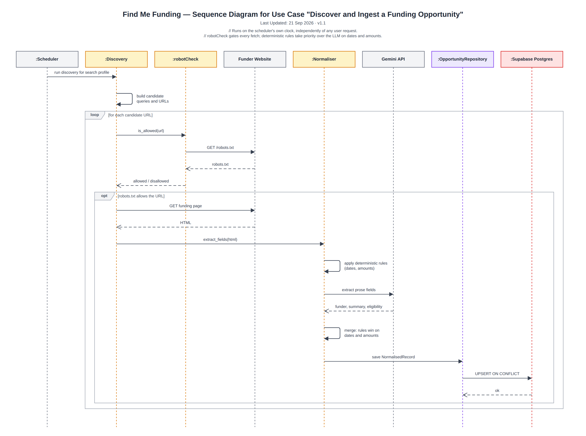

# Sequence Diagram — Discover and Ingest

> Snapshot of the Confluence page [Sequence Diagram — Discover and Ingest](https://annaseku01.atlassian.net/wiki/spaces/Crawlers/pages/31391755), taken 23 October 2026. The live page needs an Atlassian login. The client is referred to by role, not by name.

The scheduled crawl. robotCheck gates every fetch, and deterministic rules win over the LLM on dates and amounts.

Click the image to view it full size. Editable source: `docs/diagrams/sequence-crawl-ingest.drawio` in the repository (PNG export in `docs/diagrams/png/`). Where this page and the repository disagree, the repository wins.

Part of the architecture set — start at [Architecture Overview — Find Me Funding](architecture-overview-find-me-funding.md).
