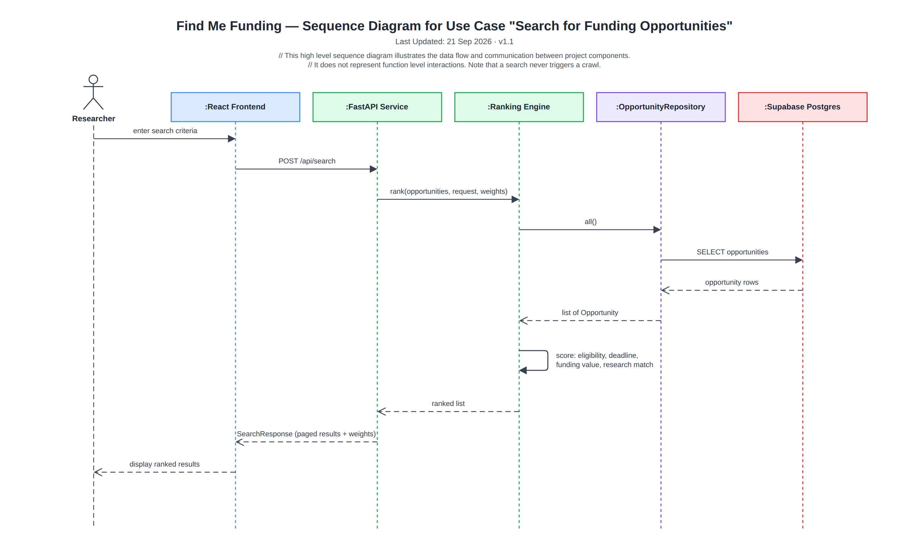

# Sequence Diagram — Search for Funding

> Snapshot of the Confluence page [Sequence Diagram — Search for Funding](https://annaseku01.atlassian.net/wiki/spaces/Crawlers/pages/31784961), taken 25 October 2026. The live page needs an Atlassian login. The client is referred to by role, not by name.

A user search, end to end. A search never triggers a crawl.

Click the image to view it full size. Editable source: `docs/diagrams/sequence-search-funding.drawio` in the repository (PNG export in `docs/diagrams/png/`). Where this page and the repository disagree, the repository wins.

Part of the architecture set — start at [Architecture Overview — Find Me Funding](architecture-overview-find-me-funding.md).
