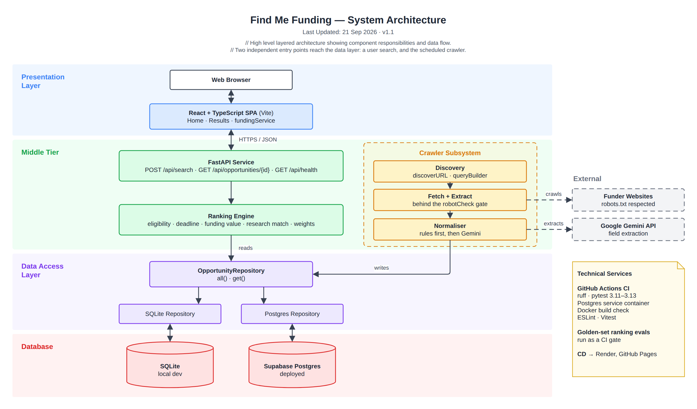

# System Architecture (Layered)

> Snapshot of the Confluence page [System Architecture (Layered)](https://annaseku01.atlassian.net/wiki/spaces/Crawlers/pages/31522817), taken 25 October 2026. The live page needs an Atlassian login. The client is referred to by role, not by name.

Layered, module-level view. Two independent entry points reach the data layer: a user search, and the scheduled crawler.

Click the image to view it full size. Editable source: `docs/diagrams/system-architecture.drawio` in the repository (PNG export in `docs/diagrams/png/`). Where this page and the repository disagree, the repository wins.

Part of the architecture set — start at [Architecture Overview — Find Me Funding](architecture-overview-find-me-funding.md).
